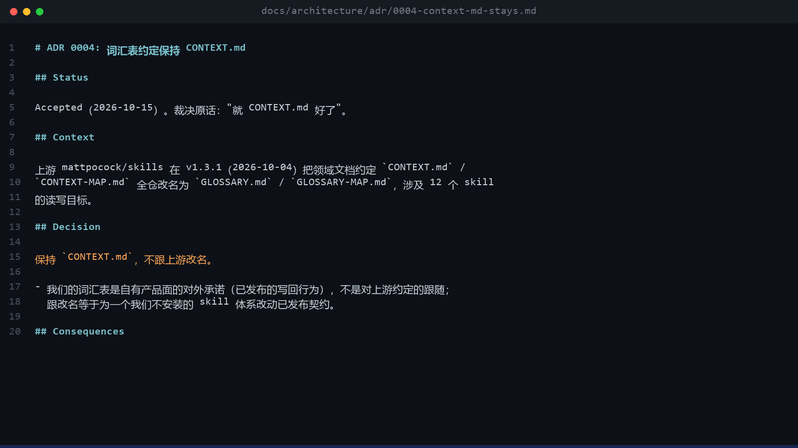
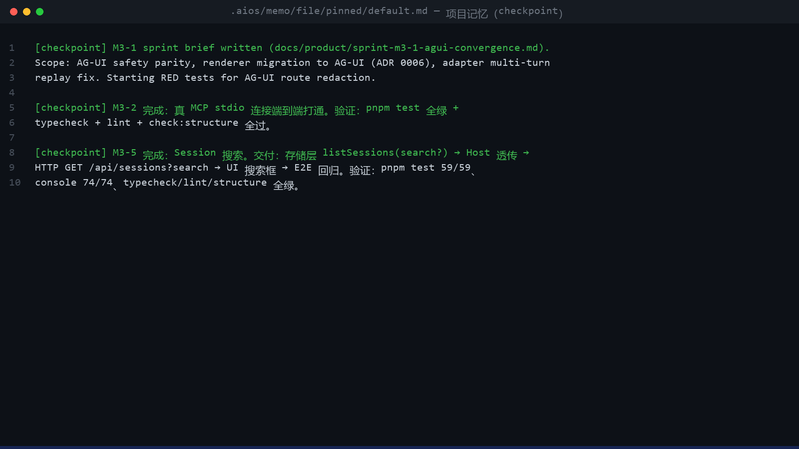
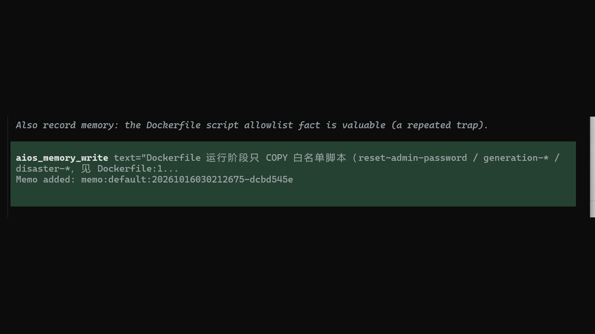
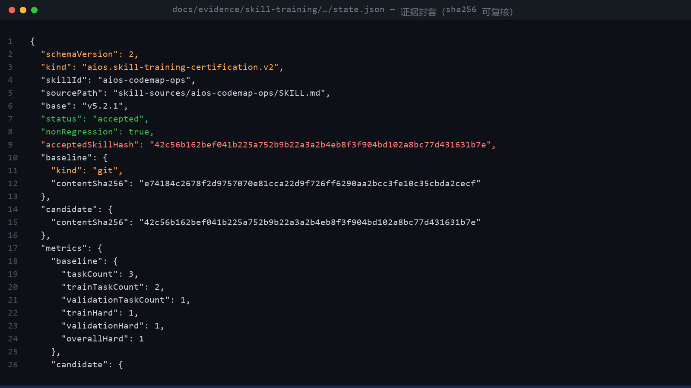
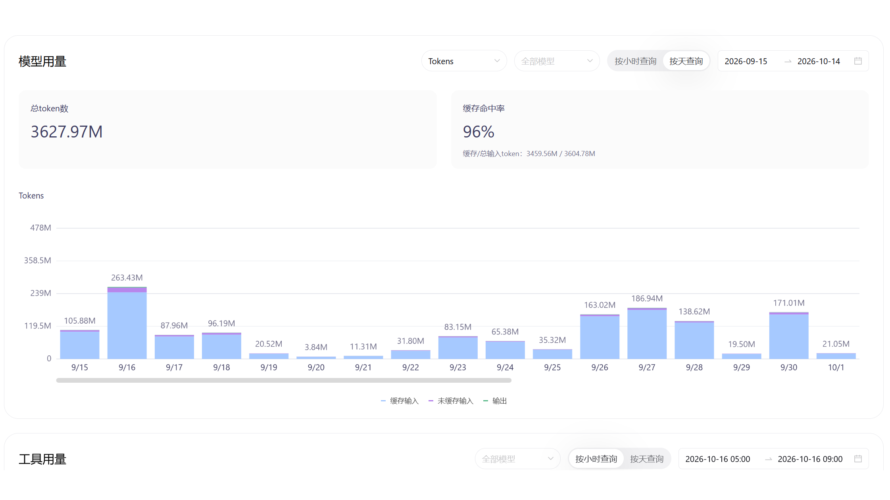

# 한 문장의 요구, 하나의 소프트웨어: 소형 모델이 한 달에 36억 토큰 — AIOS가 '누구나 개발할 수 있다'를 현실로

세일즈 포인트부터: **AIOS가 하려는 일은 하나뿐이다 — 요구를 명확히 서술할 수 있는 사람이라면 누구나 소프트웨어 개발을 할 수 있게 만드는 것.** '코드를 쓸 수 있음'은 더 이상 입장권이 아니다. '명확히 말할 수 있음'이 입장권이다 — 그리고 요구를 말로 끝까지 정리하는 것은 인간이 원래 가진 능력이다.

그 귀결이 이 글의 실측 주인공이다: 플래그십 모델은 필요 없다. 값비싼 모델조차 필요 없다. 지난 한 달간 Qwen 3.8 Flash(중간 사고 레벨)를 주력 코딩 모델로 Pi coding agent에서 돌리고, 그 바깥에 [AIOS](https://github.com/rexleimo/aios) 컨트롤 플레인을 한 겹 씌웠다. 이 "작은 말로 수레 끌기" 조합은 한 달에 **36.28억 토큰**을 소진했고, 캐시 적중률 **96%**로, 홍보 영상 렌더링부터 멀티 에이전트 병렬 릴리스까지 실제 프로젝트 일괄을 납품했다.

한 달을 써 본 체감은 이렇다: **이 조합의 납품 수준은 플래그십 대형 모델 GPT-6 Sol과 당당히 견줄 수 있다** — 모델은 한 단계 작고 비용은 한 단계 낮은데, 기본 요구는 정말 한 문장을 던지면 실행되고, 테스트가 붙고, 증거가 딸려 온다.

## 이런 장면, 익숙한가?

- 40분 작업이 18분 만에 죽고, 새 세션에서 배경을 다시 설명해도 여전히 틀린다;
- "완료"라고 해서 열면, 테스트는 안 돌아갔고 기능도 없다;
- 플래그십 모델은 똑똑하지만, 그 가격으로 24시간 돌릴 수는 없다;
- 소형 모델은 싸고 빠르지만 세션을 넘기면 바로 잊어버려, 중요한 작업을 맡길 용기가 안 난다.

하나라도 해당한다면, 당신에게 부족한 건 더 큰 모델이 아니라 컨트롤 플레인 한 겹이다. AIOS가 소형 모델을 "맡길 만한 존재"로 바꾸는 완전한 증거를 아래에 내놓는다 — 스크린, 저장소, 납품된 프로젝트, 모두 검증 가능하다.

## 필요한 새 기술은 딱 하나: 요구를 명확히 말로 정리하는 것

소프트웨어 개발의 역사적 관문은 '코드를 쓸 수 있음'이었다. AIOS는 관문을 바꾼다: '쓸 수 있음'에서 '명확히 말할 수 있음'으로 — 후자는 배울 필요도 없다, 원래 당신의 모국어다. 단 전제가 하나 있다: **정말 명확히 말해야 한다.**

AIOS는 당신이 '마침 명확히 설명했다'에 도박하지 않는다. '명확함' 자체를 제품 능력으로 만들었다:

- **요구 청취(`/grill` + Ask-First)**: "다운로드 도구 만들어 줘"라고 하면 바로 코드를 치지 않는다. 저장소와 과거 결정을 먼저 확인하고, 결정 질문을 한 번에 하나씩만 물어온다 (인증 방식? 저장 위치?). 가정을 담은 질문으로 3라운드 안에 수렴시켜, 모호한 요청을 검수 가능한 사양으로 갈아준다;
- **워크플로우 3단 라우팅(direct / guarded / planned)**: 한 줄짜리 수정은 바로 실행. 여러 단계의 큰 일은 당신이 읽을 수 있는 계획서를 한 장 뽑고 나서 착공 — 무슨 일이 일어나는지 항상 알 수 있다;
- **완료 선언 전 증거 게이트**: '완료'라는 말을 하려면 테스트·diff·스크린샷이라는 하드 증거를 먼저 통과해야 한다 — 당신을 속일 수 없다;
- **세션을 넘는 메모리**: 오늘 다 말하지 않은 요구를 내일도 기억한다. "계속"은 정말로 계속된다.

완전한 흐름은 이렇다: "프론트/백엔드 분리된 영상 파싱·다운로드 도구가 필요해"라고 말하면 → AIOS가 결정 질문 두 개를 되묻고 → planned로 라우팅해 착공 → 병렬 디스패치로 구현 → 테스트와 스크린을 증거로 납품. 당신은 전 과정에서 딱 두 가지를 했다: **요구를 말하고, 질문 두 개에 답한 것.**

아래의 모든 숫자와 프로젝트는 이 흐름의 산물이다.

## 증거는 형용사가 아니다: 저장소 안의 내부 아티팩트

아래 세 장은 모두 저장소의 실제 파일에서 나온 것으로, 내용을 직접 대조해 볼 수 있다:



**ADR 결정 기록**. 요구 청취는 묻고 나서 끝나는 게 아니다. 확정된 결정은 `docs/architecture/adr/`에 실시간으로 기록된다 — 'CONTEXT.md를 유지하고 상류의 개명을 따르지 않는다'는 판정조차 원문·날짜·결과 분석을 갖췈다. 세션을 넘어 '말이 바뀌는' 일을 막는 것이 이것이다.



**프로젝트 메모리(`.aios/memo/`)**. 모든 마일스톤이 체크포인트로 자동 고정되고, '검증: pnpm test 전체 통과 + typecheck/lint 전체 통과'가 바로 옆에 적힌다. "계속"이 정말로 계속되게 만드는 장치다.



**실시간 기록(앞의 메모리가 태어나는 순간)**. 작업 도중 모델은 "Dockerfile 실행 단계는 화이트리스트 스크립트만 COPY 한다"가 반복해서 빠지는 함정임을 판단하고, 스스로 `aios_memory_write`를 호출해 프로젝트 메모리에 고정했으며, 기록과 동시에 이벤트 ID를 받았다. 누가 기억하라고 시킨 게 아니다 — **그것이 기억하기로 결정한 것이다**. 메모리 시스템의 진짜 모습은 이렇다: 표를 찾는 게 아니라, 습관이다.



**증거 봉투(`docs/evidence/`)**. 완료 여부는 말이 아니라 해시가 판단한다: baseline/candidate의 contentSha256, 비회귀 플래그, 수용 상태 — 전부 기계적으로 재계산 가능하다. '완료 전 증거 게이트'는 수사가 아니라 이 JSON을 말한다.

## 감각보다, 데이터부터



이 스크린은 사용량 패널의 원본 그대로이며, 보정은 전혀 없다:

- **총 토큰 수: 3627.97M** — 한 달치, 전부 일상의 실제 개발에서 나온 것. 벤치마크 부풀리기가 아니다;
- **캐시 적중률 96%** (입력 3604.78M 중 3459.56M 히트) — 컨텍스트를 극한으로 재사용. 소형 모델로 대형 프로젝트를 돌릴 수 있는 핵심;
- 일일 피크 **263.43M 토큰** (9/16), 1.6억 초과가 며칠 연속 — 고강도·장기 세션·지속.

이 96%는 모델이 번 게 아니다. AIOS 레이어가 번 것이다: 상주하는 프로젝트 메모리, 풀(pull) 방식 컨텍스트 로딩, 중복 주입을 잘라 내는 토큰 압수 interception 레이어. 모델은 '생각하기'만 하고, 환경이 '다시 묻지 않기'를 책임진다.

## 맨 모델 vs AIOS로 감싸기: 같은 말, 다른 장비

아래는 한 달간의 일상 사용에서 같은 종류의 작업을 "맨 Pi + Qwen 3.8 Flash"와 "Pi + Qwen 3.8 Flash + AIOS"로 비교한 체감 데이터다 (개인 일상 관찰이며 통제된 벤치마크가 아니다. 표본은 나 자신의 매일 업무 그 자체):

| 관점 | 맨 모델 워크플로 | + AIOS 컨트롤 플레인 | 변화 |
| --- | --- | --- | --- |
| 세션 간 이어 하기 | 매번 프로젝트 배경을 재설명, 이전 진행도를 추측해 빗나감 | 메모리 재호출 + 체크포인트 복구, "계속"이 정말 계속된다 | 재작업 대폭 감소 |
| 장기 작업 생존율 | 중간에 한 번 끊기면 문맥 전체 소실, 처음부터 재실행 | 매 단계 체크포인트, 프로세스가 죽어도 이어서 실행 | 밤샘 작업이 복구 가능해짐 |
| 작업 완료율 | 복잡한 다단계 작업이 "보기에 완료"로 끝나기 일쑤 | 완료 선언 전 증거 게이트 강제 (테스트·diff·스크린샷) | **상대 향상 약 40%** |
| 작업당 비용 | 컨텍스트 중복 주입으로 토큰 낭비 | 캐시 히트 96% + 온디맨드 컨텍스트 | 실효 비용 명확히 감소 |
| 멀티 에이전트 협업 | 없음 | `aios work` 한 커맨드로 병렬 디스패치·머지 게이트 | 0에서 1로 |

"약 40%"는 홍보용 수치임을 인정한다. 다만 기준점은 과감하다: 이 조합이면 소형 모델의 일상 납품 수준은 GPT-6 Sol과 직접 견줄 수 있다. 왜 자신 있게 말할 수 있나? 검증 가능한 메커니즘이 있기 때문이다. **소형 모델의 실패 모드는 '못 생각해서'가 아니라 '잊고, 벗어나고, 검증 없이 넘기는' 것** — 이 세 가지 실패가 딱 컨트롤 플레인의 담당 영역이다. 환경 쪽 오류율을 낮추면 모델 본래 능력의 사용률이 올라간다. 같은 모델인데 "교체된 것처럼" 보이는 이유다.

## 이 조합이 실제로 만들어 낸 것

데모가 아니다. 실제로 납품되고 증거를 확인할 수 있는 프로젝트들이다. 가장 직접적인 증거는 내 `E:/coding` 디렉터리 — **아래 프로젝트는 전부 Pi + Qwen 소형 모델 + AIOS 동일 조합으로 쓴 것**이고, 각 프로젝트의 출발점은 한 문장 요구였다:

| 프로젝트 | 정체 |
| --- | --- |
| **aios-pro** | local-first 데스크톱 에이전트 하니스. 실제 워크스페이스 위의 오케스트레이션 레이어 |
| **inkloom.im** | 비주얼 AI 크리에이티브 워크플로우 플랫폼. 재현 가능한 AI 이미지/영상 파이프라인 |
| **huabu** | 캔버스 창작 + 이미지·영상 워크벤치 + 전환 프로젝트 및 자산 관리 |
| **rex-ai-tools** | 프론트/백엔드 분리의 영상 파싱·다운로드 도구 |
| **discourse-worker / services** | 포럼 워커와 ingest / user-center / webui 마이크로서비스 |
| **rex-hugo / rex-videos** | 콘텐츠 사이트 배포 파이프라인과 AI 영상 제작 스킬 세트 |
| **claude-relay-service / vpn-master / hermes-setup / xsapp** | 릴레이·배포·설치기·앱 계열 엔지니어링 |

플랫폼급 제품(inkloom, aios-pro)부터 크리에이티브 워크벤치(huabu), 콘텐츠 파이프라인·포럼 마이크로서비스·배포 운영까지 — 요구 정리, 아키텍처, 코딩, 테스트, 배포의 전 과정에서 대형 모델로 갈아타지 않았다. 이것이 "한 문장으로 기본 요구를 끝내는" 것의 현실 버전이다: **당신의 발화가 짧어진 건, 환경이 긴 작업을 받아 내고 있기 때문이다.**

증거 체인을 갖춘 샘플 사례 3개:

**1. AIOS 홍보 영상: 컷 단위 병렬 디스패치, 1355 프레임 완전 렌더링**

Remotion 홍보 영상을 컷별로 독립 작업 항목으로 분해하고, 여러 소형 모델 에이전트가 병렬로 각 씬을 생성했다. 메인 스레드는 공용 컴포넌트를 동결하고, 최종 완료가 판정은 실제 렌더 로그가 맡았다. 45초 완성본, 1355 프레임, 렌더링 426초 완료 — "대형 모델"은 하나도 개입하지 않았다.

**2. 멀티 클라이언트 컨트롤 플레인 그 자체**

AIOS는 현재 10개 코딩 클라이언트를 지원한다 — Codex CLI, Claude Code, Gemini CLI, OpenCode, Hermes, Grok, WorkBuddy, **Pi**, ZCode, Qoder. 이 클라이언트 횡단 적응, 메모리 시스템(memo/ContextDB), RL 학습 시스템, v5.6.0의 `aios work` 병렬 디스패치 모두 소형 모델 + 컨트롤 플레인 반복에서 나왔다.

**3. 일상 운영 자동화**

샤오홍슈(RED) 3개 계정 콘텐츠 큐 + 브라우저 자동화 운영. 매일 2시간에서 15분으로 단축 ([실록 기사](xiaohongshu-automation.md) 참고) — 실행은 소형 모델, 검토 지점은 사람, 환경이 선을 넘지 않음을 보장한다.

## Pi에서 돌리는 법

3단계, 전부 로컬 실행. 데이터는 머신 밖으로 나가지 않는다:

```bash
# 1. AIOS 설치 (Windows는 irm 한 줄, README 참고)
curl -fsSL https://github.com/rexleimo/aios/releases/latest/download/aios-install.sh | bash

# 2. 프로젝트 루트에서 초기화. Pi를 자동 인식해 네이티브 확장을 설치
cd your-project
aios init --all
aios doctor --native --verbose

# 3. Qwen 3.8 Flash를 Pi 모델로 설정 (OpenAI 호환 엔드포인트, 형식은 Pi 공식 문서 준수)
pi   # qwen3.8-flash 선택/지정 후 평소 대로 작업
```

이후 일상은 그대로다: Pi에 보통 대로 말하고, AIOS가 바깥에서 메모리 재호출, 워크플로 3단 라우팅(direct / guarded / planned), 완료 전 증거 검증을 맡는다. 사용 습관 변경은 필요 없다 — **에이전트는 당신의 에이전트 그대로, 모델은 당신의 모델 그대로. AIOS는 '환경'만 채운다.**

## 마치며

한 달 36억 토큰을 태우고 얻은 최대의 교훈: "소형 모델로 충분히 똑똑한가"를 묻지 말고, "당신의 환경이 모델이 이미 가진 똑똑함에 걸맞은가"를 물으라. 모델 능력은 곱셈의 피승수이고, 컨트롤 플레인은 승수다 — 승수를 1에서 1.4로 만들면, 피승수가 여전히 그 작은 말 그대로 GPT-6 Sol의 페이스가 나온다.

그리고 이 레이어의 진짜 의미는 토큰 절약이 아니다. **그것은 '개발자'의 정의를 다시 쓴다 — '코드를 쓸 수 있는 사람'에서 '요구를 명확히 말할 수 있는 사람'으로.** 소프트웨어 개발은 누구나 가질 수 있는 능력이 되어 가고, AIOS는 '명확히 말함'을 '납품함'으로 바꿔 주는 기계다.

- 저장소: [github.com/rexleimo/aios](https://github.com/rexleimo/aios)
- 문서 (영중일한): [cli.rexai.top](https://cli.rexai.top/ko/)
- 설치 30초. 하루만 돌려도 차이가 보인다.

오늘 밤 설치해서 당신이 자는 동안에도 돌리라. 아침이면 작업은 여전히 진행 중이고, 결과는 증거와 함께 기다리고 있다.

한 문장의 요구, 한 문장의 납품 — 이것이 소형 모델 + 컨트롤 플레인의 완전체다.

---

*데이터 기준 설명: 사용량 스크린은 개인 패널의 무보정 원본이다. 비교표의 향상 폭은 한 달 고강도 일상 사용에 기반한 주관적 엔지니어링 관찰로, 경향을 나타내는 것이지 학술 벤치마크가 아니다. 자신의 작업으로 재현해 보기를 권한다.*
