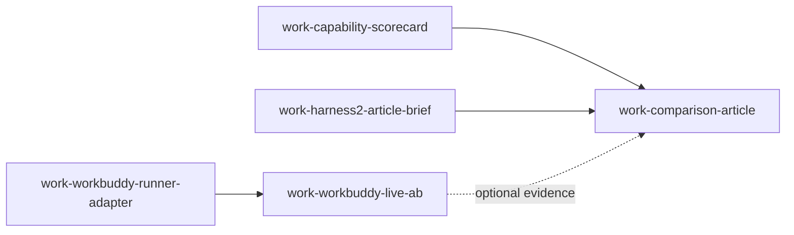

# WorkBuddy 打分 + 对标 Google harness 2 文章的内容产出

> AIOS Planning Contract (schema v3)
> created: 2026-10-19T07:09:36.695Z
> client: pi
> source: mcp:aios_plan_start
> route: unknown

## Objective

在对标 Google 发布的 harness 2 文章的前提下，产出 AIOS 侧可发布的评分内容，并对 WorkBuddy 做一次有据可查的打分：本地能力记分卡先落地（B 路线），真实 A/B 实测（A 路线）作为待批准后续项。

## Route skills

1. `Rex selects the current provider`

## Tasks

任务图不在此文重述，唯一权威来源：

- Decision Ticket: `docs/plans/2026-10-19-workbuddy-harness-scorecard-decision-ticket.json`（`artifact:decision-ticket:workbuddy-harness-scorecard-20261019`）
- Delivery Ticket: `docs/plans/2026-10-19-workbuddy-harness-scorecard-delivery-ticket.json`（`rex.delivery-ticket.v1`，含 workItems / frontier / parallelGroups / convergenceGate）

工作项一览（详验收与验证命令见 Delivery Ticket）：

| work id | dependsOn | 状态 | allowedWrites | failureClass |
| --- | --- | --- | --- | --- |
| `work-capability-scorecard` | — | ready | `scripts/client-capability-scorecard.mjs`、`scripts/tests/client-capability-scorecard.test.mjs`、`docs/reports/2026-10-19-client-capability-scorecard.md` | schema-drift（config 字段形状变化）|
| `work-harness2-article-brief` | — | blocked（需人工输入 URL） | `docs/reports/2026-10-19-harness2-article-brief.md` | external-unreachable |
| `work-workbuddy-runner-adapter` | — | blocked（需路线批准） | `docs/plans/2026-10-19-workbuddy-runner-adapter-design.md` | needs-approval |
| `work-workbuddy-live-ab` | `work-workbuddy-runner-adapter` | blocked | `docs/reports/`、`scripts/lib/learning/gaia-ab-eval/` | needs-approval + cost |
| `work-comparison-article` | `work-capability-scorecard`、`work-harness2-article-brief` | blocked（汇合） | `blog-site/`、`blog-site/zh/`、`mkdocs.blog.yml` | unverified-source |

## Dependency graph

最短关键路径：`work-capability-scorecard → work-comparison-article`（其余为汇合前的并行/阻塞支）。`work-workbuddy-runner-adapter → work-workbuddy-live-ab` 与 B 路线无依赖关系，未获批则不进入本次交付。

## Progress

- status: active
- 本轮只完成规划层：未启动实施、Team、Harness，未调用下一个 Provider。

## Facts（本轮已验证，下游只读这些字段）

- **F1** `scripts/lib/learning/gaia-ab-eval/client-adapters.mjs:42-100` 仅配置 `hermes` / `claude` / `codex` 三个 CLI spawn adapter；其余 client 报 `GAIA client adapter is not configured for ${client}`。
- **F2** `config/host-capabilities.json` 中 `clients.workbuddy` = `targetLevel L2`，`capabilities: [mcpProxy, compactPacket]`，limits 含 “No standalone CLI binary…”，`requiredEntrypoint: aios-managed-runner`，`directHostBypassAllowed: false`。
- **F3** `docs/reports/2026-07-23-workflow-intelligence-diagnostic-codex-bbh20.md` 提供可复用的评分报告范式（digest 钉定双组、隔离临时目录、禁工具与网络、非 leaderboard）。
- **F4** planning Provider 的 `aios_capability_evidence` MCP 面存在已知校验缺陷（`docs/plans/2026-09-18-triage-…currently.md`）；本轮无 `activationId` / `AIOS_REX_EVIDENCE`，证据 in-band 交付。
- **F5** 本环境外部查证通道失效：`curl` 直连返回 000；DuckDuckGo（含 lite/html）对 headless 浏览器返回空快照；`browser_screenshot` 报 `ReferenceError: __name is not defined`。因此 Google “harness 2” 文章内容**未查证**。

## Decision Log

- 2026-10-19 **D1** B 路线先行、A 路线登记为待批准后续项（`assumed-default`，来自 `/grill` 的 assumptions-recorded + 本轮 `/rex-planning` 空尾调度）。理由：A 路线需新执行通道（F1/F2）且涉及外部模型调用成本，属 ask-before-cost 边界。
- 2026-10-19 **D2** 不将本目标合入已有的 2026-09-28 计划（objective 无关），新建单一工作项契约。

## Acceptance

- Delivery Ticket 的 `convergenceGate` 为唯一验收门；具体命令输出为证据，勾选框不是证据。
- 若 A 路线未获批，本 spec 的完成声明限于 B 路线 + 显式「WorkBuddy 实测为不可测/未授权」的记录。

## Next Actions

1. 执行 `work-capability-scorecard`（当前唯一 ready 项）。
2. 向用户索取 Google harness 2 文章链接/标题，解除 `work-harness2-article-brief`。
3. 请示是否批准 A 路线（成本 + 新通道）。

## Verification evidence

- Attach via `aios plan add-evidence --kind command|path|test --value "..."`
- Plan cannot be `done` without evidence and completed tasks
- 本轮规划层证据（in-band，per F4）：
  - `file:docs/plans/2026-10-19-workbuddy-harness-scorecard-decision-ticket.json`
  - `file:docs/plans/2026-10-19-workbuddy-harness-scorecard-delivery-ticket.json`
  - `file:config/host-capabilities.json#clients.workbuddy`（F2）
  - `file:scripts/lib/learning/gaia-ab-eval/client-adapters.mjs#L42-L100`（F1）

## Status

- status: active
