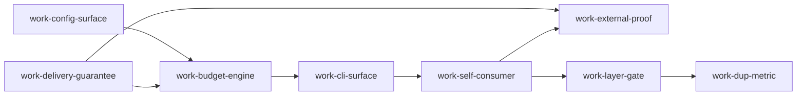

# 计划：工程标准规则抽离为可复用检查命令（portable-standard-rules）

> 复用入口：`docs/plans/2026-10-22-portable-standard-rules-delivery-ticket.json`（`rex.delivery-ticket.v1`，
> 由 `normalizePlanningArtifact` 校验通过）
> 需求决定：`docs/plans/2026-10-22-portable-standard-rules-decision-ticket.json` + `docs/adr/0002-portable-engineering-standard-rules.md`
> 激活：capability `software.planning.sequence` / stage `sequence` / provider `rex-planning`

## 落点（父仓库 / 子模块）

判据沿用 `docs/architecture/adr/0001-submodule-landing-boundary.md:30`（"第三方可独立安装使用"的公开产品面→子模块，其余留父仓库）。
修正后的实质结论：**引擎、规则清单与默认预算、检查命令实现、分层 schema、wiring 担保测试全部落子模块**，
父仓库只留 `aios standards check` 转发 + 本仓库消费方迁移 + 投影重生与 doctor 漂移报告。

| 落点 | 工作项 | 代价 |
|---|---|---|
| 子模块 | config（清单与默认值）、engine、cli 实现、layer schema、wiring 测试、dup 度量 | 必须走子模块自己的发布流（CHANGELOG + semver + tag，现 0.11.1）→ **批量成一个 release，不是一项一发** |
| 父仓库 | `aios` 转发适配、self-consumer 私有门退役、投影重生 + doctor 漂移、AIOS 自己的分层声明 | 子模块指针移动**单独 commit**，不混提 |
| 不改代码 | external proof（证据落目标仓库自己） | — |

关键修正：原计划写"默认预算随 AIOS 发行"，那会让目录 8 / 单文件 400 这两个数字拥有两个 owner
（子模块 §4 文本 + 父侧常量），正好复现那条 ADR 认定为"决策语义外泄"的缺陷。现在默认值唯一权威在子模块，
父侧只能读取，并由契约测试保证逐项相等。

## 依赖图（真实先后，不是文件清单）



关键路径 5 hop：`work-config-surface → work-budget-engine → work-cli-surface → work-self-consumer → work-layer-gate → work-dup-metric`。

**真并行边界**：`work-config-surface` ∥ `work-delivery-guarantee`（一个动配置契约与清单，一个动投影送达与 wiring 测试，文件所有权不重叠）。
第二组 `work-layer-gate` ∥ `work-external-proof`（后者是外部仓库的验证动作，不写本仓库代码）。
其余一律串行：`work-budget-engine`/`work-cli-surface`/`work-self-consumer`/`work-layer-gate`/`work-dup-metric` 都共享 standards 引擎与配置面这同一模块所有权，
并行会造成同文件冲突——`work-dup-metric` 因此被显式排在 `work-layer-gate` 之后，而不是为了好看而并发。

**修正轮新增的边**：`work-delivery-guarantee → work-budget-engine`。理由：送达是 ADR 0002 决策 4 明写的前提，
而且两项都要改投影通路（重生 / marker / 漂移报告）。于是 `work-delivery-guarantee` 从"可并行的旁支"变成了**引擎的上游**：
它仍可并行开工，但**不能再被当成可延后的事**。

## 每步的验证与回退点

| work | 完成条件的判定方式 | 失败/超限时的回退点 |
|---|---|---|
| work-config-surface | `rule-config.test.mjs`：未知键、缺 reason 的 exempt、非法预算都必须结构化报错 | 契约不成立就退回 ADR 0002 重开，不实现"能读就行"的宽松解析 |
| work-delivery-guarantee | 漂移审计数从 45/66 归零 + `rex-standards-wiring.test.mjs` 有"删掉第 0 步即变红"的真反例 | 若投影重生无法在 update 路径挂钩，本条降级为 doctor 只报警，**第一期不阻塞后续切片**，但必须在 ticket 里记 blocked 原因 |
| work-budget-engine | 现有 `dir-budget.test.mjs` 全绿 + 任意 rootDir fixture 通过 | 引擎改动若使本仓库预算报告出现新红灯，先迁豁免/基线数据再继续，不得放宽默认值 |
| work-cli-surface | CLI 契约测试（0 与非 0 两条路径）+ 临时仓库 fixture 红→改→绿 | 若子命令面与现有 `quality-gate` 职责重叠，合并进 `quality-gate` 而不是新增第二条命令（ADR 0002 决策 4：不得裂成两个工具） |
| work-self-consumer | `npm run test:scripts` + `aios doctor --strict` 双绿，且脚本内不再有私有常量 | 24 条 facade 规则迁移若使 `evaluateArchitectureGovernance` 出现行为差，保留旧路径为**过渡**并在 ADR 记录重开裁决，不许静默双轨 |
| work-layer-gate | 两条路径都有测试：有声明 → 指名引用红灯；无声明 → SKIP + 原因 | 若 codemap 覆盖不到目标语言，退回"标明近似"输出，并在文档写明近似边界；不新写解析器 |
| work-external-proof | 目标仓库（默认 `E:/coding/rex-ai-tools`）保存真实命令输出与退出码为该仓库自己的证据 | 首次运行刷红即视为 baseline 生成缺陷，回到 work-budget-engine 修 ratchet 落盘，不得靠豁免清单掩盖 |
| work-dup-metric | 正反例：成块复制即红、提取共享结构即绿 | 误报率不可接受则本条降级为 warn-only，并回 ADR 0002 修订第一期范围 |

## 汇合门（convergenceGate）

`npm run test:scripts` + `aios doctor --strict --json` 报投影漂移 0 + rex-ai-tools 真跑证据 + wiring 反例测试，
**四者缺一不得声明完成**；本仓库若仍留有任何私有门读路径即视为未收敛。

## 结构化校验证据（真实输出，非自述）

```
VALIDATION: PASS
kind              : rex.delivery-ticket.v1 | status: ready | completionClaim: soft
decisionTicketRef : artifact:decision-ticket:portable-standard-rules
work items        : 8
frontier          : ready=[work-config-surface, work-delivery-guarantee] blocked=6
parallel groups   : [work-config-surface work-delivery-guarantee] [work-budget-engine] [work-cli-surface] [work-self-consumer] [work-layer-gate work-external-proof] [work-dup-metric]
critical path     : 5 hops
every item has verification: true
CYCLE GUARD: rejected as expected -> delivery dependency graph contains a cycle
```

校验器与投影漂移审计目前位于 `.aios/tmp/`（gitignore，不可长期作为证据）。
`work-delivery-guarantee` 的完成条件已包含"把审计提升为受版本控制的工具与测试"，
规划期不改代码，故此处如实标注，而不是把易失脚本当作可复用证据。

## Progress ledger（本轮）

```
ledger: {
  is_complete: false,
  in_progress: [],
  facts: [
    "planning ticket 通过 normalizePlanningArtifact 校验（8 work items / 无环 / frontier 全覆盖）",
    "反例自证：人为造环被拒（delivery dependency graph contains a cycle）",
    "送达现状：66 条 rex 投影中 45 条与安装源码不一致；wiring 担保测试 0 命中",
    "修正轮：落点按子模块边界 ADR 0001 重定——引擎/清单默认值/CLI 实现/schema/wiring 测试均归子模块",
    "修正轮：新增边 work-delivery-guarantee → work-budget-engine（送达是前提 + 共享投影通路），ticket 重校仍 PASS"
  ],
  assignment: { work-config-surface: implementer, work-delivery-guarantee: implementer }
}
```

`is_complete: false` —— 本轮只产出执行图与每步验证，未启动任何实施、Team 或 Harness，也未调用下一个 Provider。
